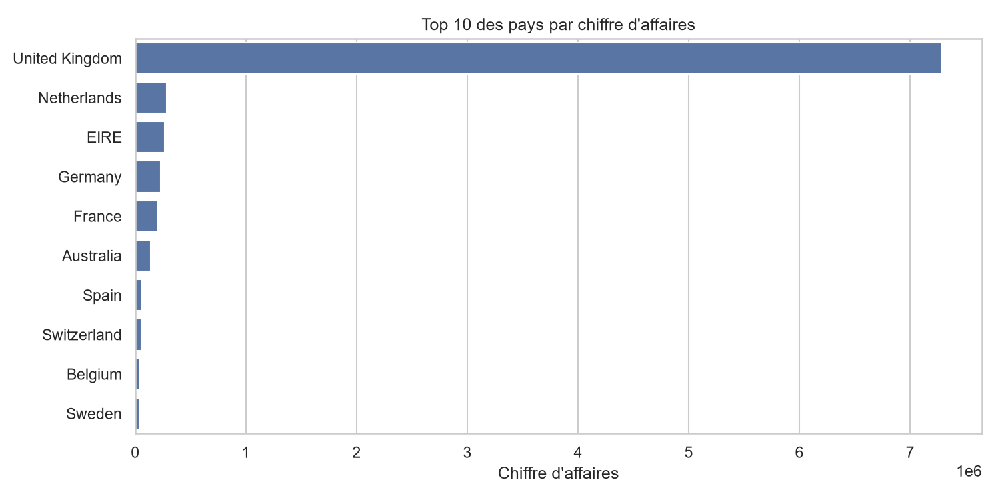
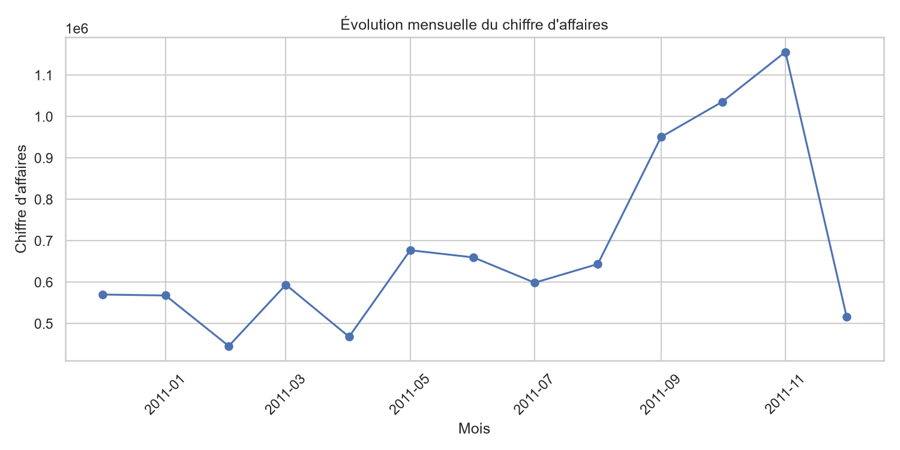
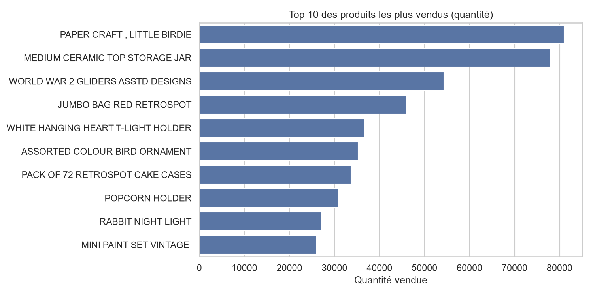
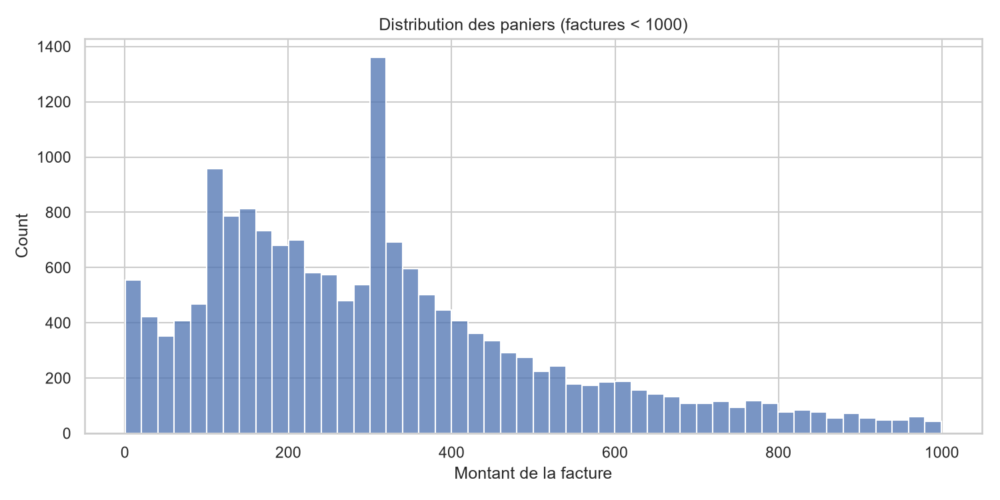

# Retail Analytics Project

## 1. Objectif

Ce projet a pour objectif d’analyser les ventes d’un commerce de détail à partir d’un jeu de données de transactions e-commerce, puis de transformer les données brutes en tableaux propres, les charger dans PostgreSQL, réaliser des analyses SQL et produire des visualisations de business insights.

L’objectif principal est de mesurer :
- le chiffre d’affaires par pays,
- l’évolution mensuelle du CA,
- les produits les plus vendus,
- la distribution du panier moyen,
- et la part des retours / ventes annulées.

---

## 2. Architecture

Le flux de données suit cette logique :

```text
CSV / Excel brut
    ↓
Nettoyage et transformation avec pandas
    ↓
Chargement vers PostgreSQL
    ↓
Requêtes SQL d’analyse
    ↓
Visualisation des indicateurs
```

### Composants
- Données source : fichier Excel/CSV brut dans le dossier data/
- Nettoyage : script Python avec pandas dans src/
- Base de données : PostgreSQL local
- Analyse : requêtes SQL dans sql/
- Visualisation : notebook Jupyter et matplotlib/seaborn

---

## 3. Données

### Source
Le projet part du fichier suivant :
- data/raw/Online Retail.xlsx

Il contient des transactions de vente en ligne avec des champs comme :
- InvoiceNo
- InvoiceDate
- StockCode
- Description
- Quantity
- UnitPrice
- CustomerID
- Country

### Décisions de nettoyage
Le nettoyage a été réalisé pour obtenir des données exploitables et cohérentes.

#### Avant / après
| Étape | Avant | Après |
|---|---:|---:|
| Nombre total de lignes | 541 909 | 392 692 |
| Lignes avec CustomerID manquant | 135 080 | 0 |
| Doublons | présents | supprimés |
| Quantité négative / prix nul | conservés initialement | supprimés |
| Type des colonnes | mixtes | normalisés |

#### Règles appliquées
- suppression des lignes ayant des valeurs manquantes critiques,
- suppression des doublons,
- calcul d’une colonne totalPrice = Quantity × UnitPrice,
- exclusion des lignes non exploitables :
  - Quantity <= 0,
  - UnitPrice = 0,
- conversion des types : identifiants et dates nettoyés,
- séparation des ventes et des retours (factures commençant par C).

Cette étape est cruciale pour éviter les erreurs de calcul sur les montants et les analyses par pays et par période.

---

## 4. Structure du repo

```text
retail/
├── .env                     # variables de connexion PostgreSQL (local)
├── .env.example             # modèle de configuration
├── .gitignore
├── requirements.txt         # dépendances Python
├── Readme.md                # documentation du projet
├── data/
│   ├── raw/
│   │   └── Online Retail.xlsx
│   └── clean/
│       ├── clean_data_sales.csv
│       └── clean_data_revenues.csv
├── notebooks/
│   ├── 01_exploration.ipynb
│   ├── 02_transformation.ipynb
│   └── 03_visualisation.ipynb
├── images/
│   ├── ca_par_pays.png
│   ├── ca_mensuel.png
│   ├── top_produits.png
│   └── distribution_panier.png
├── sql/
│   └── analysis_queries.sql
├── src/
│   ├── extract.py
│   ├── transform.py
│   ├── load.py
│   └── pipeline.py
└── venv/ / .venv
```

---

## 5. Comment lancer

### Prérequis
- Python 3.10+
- PostgreSQL installé et démarré localement
- base nommée retail
- utilisateur postgres avec mot de passe configuré

### 1) Créer l’environnement virtuel

```bash
python -m venv .venv
```

Sous Windows PowerShell :

```powershell
.\.venv\Scripts\Activate.ps1
```

### 2) Installer les dépendances

```bash
pip install -r requirements.txt
```

Si besoin, installer aussi manuellement :

```bash
pip install pandas sqlalchemy python-dotenv psycopg[binary] matplotlib seaborn openpyxl
```

### 3) Configurer PostgreSQL
Editer le fichier .env avec les bonnes valeurs :

```env
user_db=(user of data base)
user_password=(password of data base)
db_host=localhost
db_port=(number of the port)
db_name=(database name)
```

### 4) Lancer le pipeline

```bash
python src/pipeline.py
```

Cela charge les jeux de données nettoyés dans PostgreSQL dans les tables sales et revenues.

### 5) Ouvrir le notebook de visualisation

```bash
jupyter notebook notebooks/03_visualisation.ipynb
```

---

## 6. Résultats

Les graphiques générés sont dans le dossier images/.

### Chiffre d’affaires par pays


### Évolution mensuelle du CA


### Top produits


### Distribution du panier


### Constats clés
1. Le chiffre d’affaires est fortement concentré sur quelques pays, avec une domination claire des marchés les plus importants.
2. L’évolution mensuelle montre des pics de vente selon les périodes, ce qui suggère une saisonnalité ou des cycles d’activité marqués.
3. Certains produits contribuent beaucoup plus que d’autres au CA total, ce qui justifie une analyse de portefeuille et de marge.
4. Les retours et ventes annulées existent bien, mais restent à comparer au volume total pour estimer leur impact économique réel.

---

## 7. Limites et prochaines étapes

### Limites
- Le projet est un bon prototype d’analyse de données, mais il reste un workflow local à partir de fichiers et d’une base PostgreSQL locale.
- Les variables d’environnement sont sensibles et doivent être maîtrisées proprement pour éviter les fuites de credentials.
- Le fichier requirements.txt doit être vérifié et normalisé en UTF-8 pour éviter les problèmes de lecture selon l’environnement.
- Le pipeline est fonctionnel, mais il n’est pas encore complètement industrialisé pour un environnement de production.

### Prochaines étapes
- ajouter un système de tests unitaires sur les fonctions de nettoyage,
- automatiser le chargement via une commande unique de lancement,
- ajouter un dashboard plus interactif (Power BI / Streamlit / Dash),
- enrichir l’analyse avec des indicateurs marketing et financiers,
- connecter le projet à un grand projet de data engineering / BI plus complet.


---

## Conclusion

Ce projet montre un pipeline complet de traitement de données de vente : extraction, nettoyage, chargement, analyse SQL et visualisation. Il constitue une base solide pour aller vers un projet plus complet de business intelligence et de data analytics.

## 👤 Auteur

**Abderrahmane Maski**
Élève ingénieur — Génie Logiciel et Systèmes Intelligents
Faculté des Sciences et Techniques de Tanger

[LinkedIn](https://www.linkedin.com/in/abderrahmane-maski-4a46262b9) • [GitHub](https://github.com/abdoumaski04-collab)

